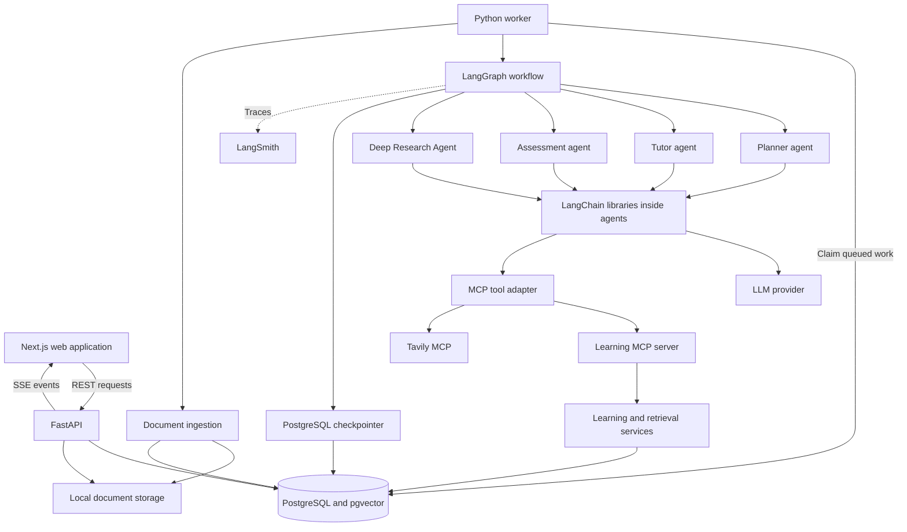
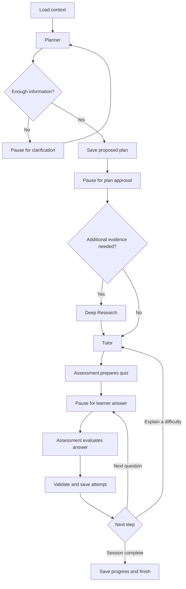

# Learn a Topic assistant

Proposed architecture, 14 November 2026. The purpose is to learn agentic application engineering through a small, reusable project. Implementation proceeds component by component.

**Scope and assumptions**

- Three main agents named Planner, Tutor, and Assessment, plus one bounded Deep Research Agent. Four agents total, following the interpretation already discussed.
- Initial use is a personal learning application with one learner exercising the system. Authentication and ownership support separate accounts from the outset.
- One topic per session, a few text/PDF documents, a short lesson, and three practice questions.
- Users can create multiple threads, approve a plan, pause at questions, and resume after reconnecting or restarting services.
- Child-specific deployment, voice, OCR, Calendar, additional document formats, and production operations can be designed as later components.
- This document specifies intended behavior. Services and credentials still need implementation and configuration.

**System structure**



The API, worker, and custom MCP server reuse one Python codebase. The worker and MCP server are small processes. PostgreSQL supplies application storage, the work queue, checkpoint storage, full-text search, and vector search. External dependencies are model/embedding APIs, Tavily, and LangSmith.

LangChain is an embedded Python library used inside the agents. It supplies model interfaces, message representations, tool bindings, and structured-output integration with Pydantic schemas. LangGraph controls workflow state, routing, interrupts, and checkpointing. Deep Agents supplies the research harness built on LangChain and LangGraph. The diagram groups shared library capabilities into one box for readability. Each agent receives its own permitted tools, with Tavily exposed to the research helper and learning tools assigned according to the agent contracts.

**Agent contracts**

| Agent | Inputs | Outputs | Available capabilities |
| --- | --- | --- | --- |
| Planner | User request, thread state, selected user memory, document summaries | Validated plan, clarification request, or selected next action | Read learning progress, list sources, request bounded research |
| Tutor | Approved plan, relevant passages, research findings, recent conversation | Lesson sections, examples, citations, follow-up prompt | Search uploaded material and read source passages |
| Assessment | Topic, lesson sources, question specification, submitted answer | Questions, rubrics, assessment feedback, suggested next topic | Retrieve supporting evidence and inspect previous attempts |
| Deep Research | Specific evidence gap, permitted source scope, search budget | Findings, citations, retrieval timestamps, remaining uncertainty | Tavily search/extract and scoped working notes |

Use LangChain model integrations and Pydantic schemas. Routing outputs are enums checked by graph logic. The graph enforces iteration, model-call, search-call, time, and output-size limits. Configure the research harness with the selected tools and no additional agent spawning for this initial four-agent scope.

Validation, ingestion, scheduling work, ownership checks, memory writes, and report persistence are ordinary application code. Agent outputs propose actions that those services validate and apply.

**Workflow**

The first implementation is in `agents/graph.py`, with shared state in `agents/state.py`. The CLI exposes it through `--agent workflow`. A new plan pauses for approval, then runs the Tutor and one Assessment question. Direct research returns its findings. Local pauses use an in-memory checkpointer for the lifetime of the CLI process. The diagram below describes the broader backend workflow planned for later stages.



The diagram shows a new lesson. The Planner can route follow-up requests to explanation, revision, or assessment. A plain question can receive a focused answer. Plan approval applies when proposing a learning session. Edits return through plan validation. Rejecting a plan returns control to the user.

Pause/resume uses LangGraph interrupts and Command(resume=...). Approval and answer endpoints address the outstanding interrupt and expected state version. Their payloads are validated before resuming the same thread. Nodes can execute again on resume, so side effects before an interrupt must be idempotent. Put side-effecting writes in dedicated validated steps.

**Threads, runs, and graph state**

- A thread is an application-owned conversation identified by a UUID and user_id.
- A run is one workflow execution triggered by a message or resume submission. Multiple runs belong to a thread.
- The graph's configurable.thread_id is the application's thread UUID. Resolve ownership on the server before supplying it to LangGraph.
- A checkpoint is a graph-state snapshot. The checkpointer manages its own tables and namespaces.
- The research invocation has a namespace associated with its parent execution. Pin and verify the chosen Deep Agents/LangGraph integration so replay and recovery preserve parent/child identity.
- User-visible thread history is stored in messages. It is a projection of validated inputs and outputs, with stable IDs to prevent duplicate publication during recovery.

Proposed typed state includes messages, current goal, plan and version, selected source references, retrieved passages, research findings, lesson, quiz identifier, question index, pending prompt, and execution budgets. Authentication context and credentials are supplied by trusted runtime context. Private answer keys stay in backend storage and are excluded from public state responses and streams.

**Memory and context construction**

| Layer | Storage | Purpose |
| --- | --- | --- |
| Thread memory | PostgreSQL checkpoints | Current conversation, intermediate outputs, and pending workflow state |
| Durable user memory | user_preferences and learning_progress | Confirmed preferences, topic attempts, and evidence of recurring difficulties across threads |
| Source knowledge | documents and document_chunks with pgvector/full-text indexes | Grounding passages from uploaded materials |
| Research working context | Thread-scoped harness backend | Intermediate notes and bounded research results |

Each invocation receives recent relevant messages, a summary of older context if needed, selected preferences, relevant learning history, and retrieved evidence. Checkpoint storage and context-window construction have separate jobs. Retaining a long conversation does not require sending its entire history on every call.

In the local web app, `agents/graph.py` appends learner messages and visible agent replies, including quiz questions, answers, and feedback, to the current thread's PostgreSQL checkpoint. `learn_topic/chat_memory.py` passes recent messages to the Planner and Tutor. They can call `search_chat_history` to retrieve older messages from that same thread. When `CHAT_EMBEDDING_MODEL` is set, `backend/chat_vectors.py` stores embeddings and passages in local Chroma and ranks earlier passages by cosine distance. The backend indexes new messages after each response and backfills missing passages on search. If vector lookup fails, it can search the checkpoint by keyword.

Memory updates preserve provenance and timestamps. A single wrong answer records an observation. The application can request more evidence before presenting a stable learning conclusion. Users can inspect and correct saved preferences and progress. Research notes remain scoped to their originating thread unless an explicit service promotes a useful result to durable knowledge.

**Database model**

| Table or table group | Main fields and constraints |
| --- | --- |
| users, refresh_tokens | Account, Argon2 password hash, token hashes, expiry and rotation state |
| threads | id, user_id, title, status, timestamps |
| messages | id, thread_id, role, content, run_id, stable publication key |
| runs | id, thread_id, trigger, idempotency key, status, lease, fencing token, heartbeat, trace ID, error |
| run_events | run_id, ordered sequence, event type, public payload |
| pending_inputs | thread_id, interrupt identifier, kind, expected version, request and accepted response |
| documents | id, user_id, thread association, content hash, storage key, ingestion status, parser version |
| document_chunks | document_id, location/page, text, embedding, full-text representation, embedding model/version |
| quizzes, questions | Thread association, source references, private answer/rubric, question order |
| attempts | User/question association, submission key, answer, feedback, hint use, evidence |
| user_preferences | user_id, preference key, value, provenance, timestamp |
| learning_progress | user_id, topic, assessment references, current summary, last reviewed time |
| jobs | Durable ingestion work, deduplication key, status, retry and lease data |
| Checkpointer-managed tables | Framework-managed checkpoints and writes |

Use SQLAlchemy async and asyncpg for application tables and Alembic for migrations. Use the driver/pool required by the LangGraph PostgreSQL checkpointer separately. Their schema setup follows the pinned package's instructions.

Enforce ownership in application services and PostgreSQL row-level security. Runtime database roles cannot bypass ownership policies. Set tenant context per transaction and reset it through pooled-connection boundaries. The MCP server derives the tenant from authenticated context, with the same service checks. Checkpoint access goes through the backend.

**Document retrieval**

The local CLI implementation lives in `learn_topic/retrieval.py`. Repeated `--notes` flags load UTF-8 text, Markdown, or text-based PDF files. PDF extraction uses pypdf and preserves page numbers. The Tutor chooses whether to call `search_notes` and can revise its query up to the three-search budget. Keyword retrieval runs by default. Setting `RAG_EMBEDDING_MODEL` to an installed Ollama embedding model adds cosine retrieval with reciprocal rank fusion. The CLI index lasts for one Tutor invocation. The persistent ingestion and PostgreSQL index described below are planned for the backend.

Upload -> validate and store -> durable ingestion job -> extract text -> chunk with source locations -> embed -> index -> mark ready.

Start with text PDFs and plain text. Use PyMuPDF for PDF extraction. Empty extraction produces a clear ingestion status. Chunk by headings where available and retain page/section metadata. Store original files on local disk and keep storage keys in PostgreSQL.

Combine pgvector search with PostgreSQL full-text search using reciprocal rank fusion. Filter by authenticated user and the thread's selected documents before returning results. Return passage IDs and locations with the text. Persist citations alongside lesson and quiz outputs. Handle repeated uploads and worker retries with document hashes and unique chunk-generation keys.

If retrieval provides insufficient evidence, request bounded research or ask for more material. Treat retrieved text as source data and preserve application instructions and tool permissions.

**MCP boundary**

The custom Learning MCP server wraps the existing service functions. Initial tools are list_learning_materials, search_learning_materials, read_source_passage, and get_learning_progress. Tool names here are proposed application contracts.

Graph services persist attempts and progress using validated agent output. This keeps updates consistent and gives the MCP server a small initial read surface. Tavily MCP supplies external research tools to the Deep Agent. Expose each agent's relevant tools and enforce call budgets.

The original stack proposed langchain-mcp-adapters/MultiServerMCPClient. Current LangChain documentation also describes the newer beta langchain.mcp.MCPAdapter. Choose and pin one compatible integration at implementation, verifying transport, tool discovery, authentication, and tracing against our selected SDK versions.

**API and frontend**

| Endpoint | Purpose |
| --- | --- |
| POST /auth/register, /auth/login, /auth/refresh, /auth/logout | Account lifecycle |
| POST /threads | Create a learning conversation |
| GET /threads | List the current user's conversations |
| GET /threads/{id} | Restore messages, active run, and pending input |
| POST /threads/{id}/messages | Persist a message and enqueue a run with an idempotency key |
| POST /threads/{id}/resume | Validate an approval/answer and enqueue continuation |
| GET /runs/{id}/events | Stream authorized public run events using SSE |
| POST /runs/{id}/cancel | Request cooperative cancellation |
| POST /threads/{id}/documents | Add learning material and enqueue ingestion |
| GET /documents/{id} | Read ingestion status and authorized metadata |
| GET /learning-progress | Read the user's durable topic progress |

A message/resume request returns a run ID quickly. The frontend separately subscribes to its event stream. Use a same-origin deployment with secure HttpOnly cookie authentication, refresh-token rotation, and CSRF protection for mutations. The SSE connection uses the same authenticated session.

Frontend areas are login, thread sidebar, conversation, document/source panel, plan approval, quiz answering, and learning-progress view. Offer retry/cancel controls and distinct states for ingestion, research, waiting for input, completion, and failure.

The local Next.js workspace proxies `/api/study/` requests to the FastAPI service in `backend/local_web.py`. The service runs the learning graph and returns public results and interrupts. Browser history lasts for the current tab session. Set `DATABASE_URL` to store workflow checkpoints across backend restarts. See [PostgreSQL setup](backend/POSTGRES.md). Authentication, application database records, and SSE are planned separately.

**Streaming and durable execution**

Public events include run_started, agent_started, tool_started, tool_finished, text_delta, sources, plan_proposed, input_required, assessment_feedback, run_completed, run_cancelled, and run_failed. Stream user-facing output and concise activity summaries. Keep secrets, private rubrics, and internal reasoning outside the public event stream.

Assign ordered event IDs and persist events, batching text deltas. Reconnect using Last-Event-ID, with a snapshot fallback after event retention expires. The frontend deduplicates events and obtains canonical final messages from thread history. Reconnecting attaches to a run and does not submit a new one.

The Python worker claims queued runs through PostgreSQL locks/leases. Allow one active workflow operation per thread. Additional messages receive an explicit busy response or are queued according to the UI action. Waiting interrupts release the execution lease while retaining the pending state.

After a worker crash, an expired lease can be reclaimed and the run reconciled with its latest checkpoint. A fencing token prevents an obsolete worker from publishing after ownership changes. Cancellation is checked between steps and propagated where tool support allows it.

Checkpoints and application tables can commit independently. Every side-effecting operation therefore uses a stable operation key and database uniqueness constraints. On replay, services return the existing committed result. A recovery pass reconciles checkpoint state, public events, pending prompts, and run status. External calls may repeat if their result was never checkpointed, so bound retries and persist expensive research results where practical.

This worker is a proposed addition to the earlier BackgroundTasks baseline. Durable queued work makes backend restart recovery demonstrable.

**Observability and evaluation**

LangSmith traces parent runs, agent activity, model calls, retrieval, and MCP calls. Attach thread/run identifiers, prompt versions, and pseudonymous user identifiers. Redact credentials and sensitive input before trace export. Measure latency, token use, estimated cost when supported, retry counts, and tool errors. Keep structured application logs for API, queue, and worker failures.

Use a small independently checked evaluation set. Check question correctness, citation support, rubric grading, unsupported-answer behavior, routing, and appropriate use of research. Deterministic fake models/tools support workflow tests. Real model evaluations measure behavior beyond those fixtures.

Acceptance scenarios include plan approval surviving restart, interrupted quiz resuming at the right question, explicit memory retrieval in a new thread, SSE reconnect without duplicate messages, repeated submissions producing one attempt, timeout recovery, correct document ownership, and cross-user access rejection. Use pytest/HTTPX for backend checks, Vitest for UI behavior, Ruff/mypy/TypeScript checks, and a full browser walkthrough for the core flow.

**Deployment and repository**

Local Docker Compose runs frontend, API, worker, custom MCP server, and PostgreSQL with pgvector. Use a shared volume for uploaded files. Configure external service credentials through environment-backed settings. Pin compatible package versions with uv and the frontend package lock.

Suggested layout

```text
frontend/
backend/
  api/
  auth/
  db/
  services/
  worker/
agents/
  graph.py
  state.py
  planner.py
  tutor.py
  assessment.py
  research.py
mcp_server/
evals/
tests/
infra/
```

GitHub Actions can run the same automated checks. S3-compatible storage, Kubernetes/k3s, Prometheus/Grafana, k6, richer parsing, and backups remain extensions of the previously discussed stack. Introduce them when the corresponding practical exercise is selected.

**Learning sequence**

1. Build the Tutor independently, with a CLI and optional LangSmith tracing.
2. Build the Planner, Assessment, and Deep Research agents one at a time, then connect them through LangGraph. Add the research tools when their agent needs them.
3. Build the backend, connect PostgreSQL, and add authentication, threads, checkpointing, document retrieval, and durable memory.
4. Build the frontend and connect it to the backend and SSE stream.
5. Test and evaluate the complete application, then package it with Docker Compose and CI.

**Reference documentation**

- [LangGraph persistence](https://docs.langchain.com/oss/python/langgraph/persistence)
- [LangGraph interrupts](https://docs.langchain.com/oss/python/langgraph/interrupts)
- [Deep Agents](https://docs.langchain.com/oss/python/deepagents/overview)
- [LangChain MCP integration](https://docs.langchain.com/oss/python/langchain/mcp)
- [Tavily MCP](https://docs.tavily.com/documentation/mcp)
- [LangSmith observability](https://docs.langchain.com/langsmith/observability)
